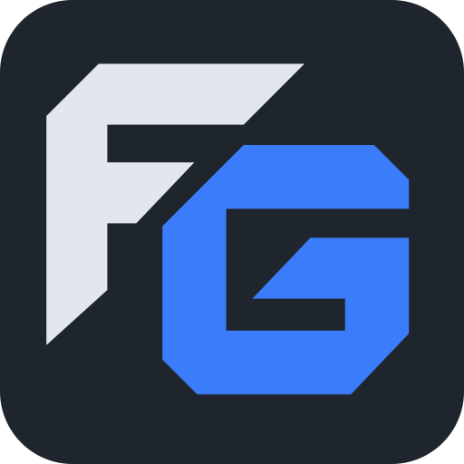

  

<h1 align="center">FG — Cộng đồng game thủ Việt Nam</h1>

Tìm đồng đội, kết bạn và cùng chơi.

FG kết nối game thủ qua Lobby theo game, hồ sơ, tìm đội, phòng nhóm, nhắn tin,
gọi thoại và chia sẻ màn hình. Dự án hỗ trợ desktop/mobile, với Bảng tin cộng
đồng, PWA và thông báo trong phạm vi phát triển.

## Mã nguồn và triển khai

- [Hướng dẫn clone, build và chuẩn bị deploy](code/README.md).
- [Đặc tả sản phẩm](.doc/01-product-spec.md).
- [Thiết kế FG đã duyệt](.doc/02-frontend-design.md).
- [Kế hoạch và acceptance từng task](.doc/task.md).

Mã nguồn ứng dụng nằm trong `code/`: React/Vite frontend, NestJS API,
PostgreSQL/Drizzle, Redis, LiveKit và OpenBao.

Dự án đang phát triển. Các gate staging, tải1.000 người đồng thời gọi/live
và release phải hoàn tất trước khi xác nhận sẵn sàng production.
