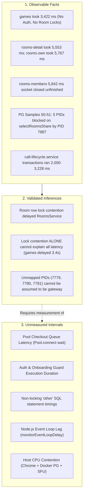

# T30 Native37 Room Load Diagnostic Analysis

## 1. Executive Summary & Verification Context

This document provides a disciplined, read-only empirical analysis of the room loading timeout in the FG T30 test suite, examining canonical run Native36 (`t30-native-5979f57c026848698eaf222edf119059`) and diagnostic run Native37 (`t30-native-52ef9e26973a4a1387e441a207b5a9dd`).

### Current Verification Facts
- **Application & Guard Baseline**: Current API build 10 and all 110 guard cases pass across 5 regression groups.
- **Both Runs Failed Native Acceptance**:
  - In Canonical36, joins completed in 5,111 ms and 4,488 ms; the viewer failed initial room region visibility within 5,000 ms. No media captures, RTP flow, or quota validations were achieved.
  - In Diagnostic37, joins completed in 5,766 ms and 6,535 ms; the viewer similarly timed out at 5,000 ms.
- **Teardown & Lifecycle Integrity**: In both runs, all 5 cleanup flags settled true. Inspector client reservation, zero errors/write failures, socket termination, and pool termination settled healthy. In Native37, PG wait observation (65 samples) and API health reported 0 failures and complete observation.
- **Visual Review & Delivery**: All 3 headed viewport captures per run were reviewed (Photo 1: app shell; Photo 2: sender group/team loading; Photo 3: viewer skeleton/3D loader) with synthetic identities, redacted secrets, and verified Telegram delivery receipts.
- **No Claim of Fix**: Neither run satisfies native application acceptance. No claim of timing remediation or root cause closure is made.

---

## 2. Empirical Review of Native37 & Native36 Evidence

### 2.1 HTTP Timing Evidence (`native37-safe-timing-summary1.json`)
The diagnostic HTTP observation recorded 88 incoming requests. When the viewer actor navigated to the room, an initial burst of parallel requests arrived between `07:49:16.066Z` and `07:49:16.120Z`:

| Sequence | Method | Route | Started At | Completed At | Duration (ms) | Status | Finished vs Closed |
| :---: | :---: | :--- | :--- | :--- | :---: | :---: | :--- |
| 55 | GET | `games` | `07:49:16.066Z` | `07:49:19.488Z` | **3,422** | 200 | Finished (true) |
| 56 | GET | `rooms-own` | `07:49:16.101Z` | `07:49:21.868Z` | **5,767** | 200 | Finished (true) |
| 57 | GET | `rooms-detail` | `07:49:16.111Z` | `07:49:21.664Z` | **5,553** | 200 | Finished (true) |
| 58 | GET | `rooms-members` | `07:49:16.120Z` | `07:49:21.962Z` | **5,842** | 200 | **Unfinished Close** |
| 61 | GET | `play-detail` | `07:49:17.371Z` | `07:49:21.319Z` | 3,948 | 200 | Closed (false) |
| 65 | GET | `play-requests` | `07:49:18.146Z` | `07:49:21.280Z` | 3,134 | 200 | Closed (false) |
| 66 | GET | `rooms-members` | `07:49:18.265Z` | `07:49:21.321Z` | 3,056 | 200 | Closed (false) |

#### Distinction on `rooms-members`
In `routeStats`, `rooms-members` shows `allFinished: false`. Although sequence 58 took 5,842 ms, the route summary indicates an incomplete transfer: the socket closed before normal stream completion. It must not be cited as a completed successful 200 response. In parallel, sequence 66 was terminated at 3,056 ms due to socket abort. Only `rooms-detail` (5,553 ms), `rooms-own` (5,767 ms), and `games` (3,422 ms) ran to full HTTP completion.

### 2.2 Slow Database Transactions (`api-lock-diagnostics.jsonl`)
The diagnostic instrumentation captured transactions exceeding 1,500 ms during this window:

| Recorded At | Backend PID | Owner Module | Transaction (ms) | Room Held (ms) | Group Held (ms) | Event |
| :--- | :---: | :--- | :---: | :---: | :---: | :---: |
| `07:49:17.746Z` | 7811 | `call-lifecycle.service.js` | **3,228** | 195 | 62 | commit |
| `07:49:21.866Z` | 7890 | `rooms.service.js` | **3,029** | 2,565 | 0 | commit |
| `07:49:21.662Z` | 7891 | `rooms.service.js` | **2,532** | 493 | 0 | commit |
| `07:49:21.171Z` | 7887 | `call-lifecycle.service.js` | **2,361** | 1,421 | 1,402 | commit |
| `07:49:14.337Z` | 7811 | `call-lifecycle.service.js` | 2,023 | 1,433 | 1,399 | commit |
| `07:49:19.751Z` | 7811 | `call-lifecycle.service.js` | 2,005 | 505 | 488 | commit |

### 2.3 PostgreSQL Wait State Samples (`pg-wait-diagnostics.jsonl`)
The 65 periodic snapshots (samples 46 to 51) reveal the progression of locking:
1. **Sample 46 (`07:49:16.095Z`)**: PID 7811 (`call-lifecycle.service.js`) is active with query `selectRoomsUpdate` (`isWaiting: true`, `queryAgeMs: 1,625 ms`), blocked on `transactionid` by PID 7780 (idleInTransaction, query `selectOther`).
2. **Sample 47 (`07:49:17.096Z`)**: PID 7811 is waiting on `selectRoomsUpdate` (`queryAgeMs: 2,605 ms`), blocked by PID 7779 (idleInTransaction).
3. **Sample 48 (`07:49:18.099Z`)**: PID 7811 is waiting on `selectRoomsUpdate` (`queryAgeMs: 332 ms`), blocked by PID 7810 (`teams.service.js`, idleInTransaction).
4. **Sample 49 (`07:49:19.099Z`)**: PID 7811 is waiting on PID 7781. In parallel, PID 7887 (`call-lifecycle.service.js`) is waiting on PID 7811 for `tuple` lock on `rooms`. PID 7890 (`rooms.service.js`) is active with `selectRoomsShare` (`isWaiting: false`).
5. **Sample 50 (`07:49:20.103Z`)**: PID 7887 (`call-lifecycle.service.js`) holds the exclusive room lock while executing `selectOther`. PID 7891 (`rooms.service.js`), PID 7810 (`teams.service.js`), and PID 7781 are all active and **blocked on `transactionid` waiting for `selectRoomsShare`** by PID 7887.
6. **Sample 51 (`07:49:21.107Z`)**: A pileup occurs. Five separate backends (PID 7891 [`rooms.service.js`], PID 7810 [`teams.service.js`], PID 7781, PID 7780, and PID 7831 [`calls.service.js`]) are all **active and blocked on `transactionid`** attempting `selectRoomsShare`. All five are waiting directly on PID 7887 (`call-lifecycle.service.js`). PID 7887 is in state `active` executing `commit` (duration 52 ms).

---

## 3. Code Path Walkthrough Across Named Sources

Tracing the execution paths of the four key routes illuminates the interplay between guards, services, database pools, and locks.

### 3.1 `GET /api/v1/games` (ProfilesController)
- **Controller & Guards**: Defined in [profiles.controller.ts](file:///E:/FGweb/code/apps/api/src/modules/profiles/profiles.controller.ts#L38-L45). It has **no** `SessionGuard` and **no** `RequireOnboardedGuard`. It is a public endpoint.
- **Service & Database**: Calls `ProfilesService.getGames` in [profiles.service.ts](file:///E:/FGweb/code/apps/api/src/modules/profiles/profiles.service.ts#L271-L300).
- **Execution Path**:
  1. Validates query parameters via Zod (`ListGamesQuerySchema`).
  2. Queries `games` joined with `lobbies` using `ProfilesService.db`.
  3. `ProfilesService` has an independent `pg.Pool` with `max: 5` ([profiles.service.ts#L64-L68](file:///E:/FGweb/code/apps/api/src/modules/profiles/profiles.service.ts#L64-L68)).
  4. Parses results with Zod (`GameSchema`).
- **Key Observation**: `games` does not query `rooms`, takes no row locks, does not authenticate cookies, and does not check bans. Yet in Native37, it took **3,422 ms** to complete. This delay occurred entirely outside of room locking.

### 3.2 `GET /api/v1/rooms/own` (RoomsController)
- **Controller & Guards**: Defined in [rooms.controller.ts](file:///E:/FGweb/code/apps/api/src/modules/rooms/rooms.controller.ts#L58-L67). Protected by `SessionGuard` and `RequireOnboardedGuard`.
- **Guard Path**:
  1. `SessionGuard` ([session.guard.ts#L45-L60](file:///E:/FGweb/code/apps/api/src/common/session.guard.ts#L45-L60)): Invokes Better-Auth `getSession({ disableCookieCache: true })`, querying `session` and `user` tables over `AuthService.db`. Then executes `authService.isUserBanned`, querying `admin_actions`.
  2. `RequireOnboardedGuard` ([onboarded.guard.ts#L22-L26](file:///E:/FGweb/code/apps/api/src/modules/auth/onboarded.guard.ts#L22-L26)): Invokes `authService.isUserOnboarded`, querying `profiles` and `game_interests`.
- **Service Path**: `RoomsService.listOwnRooms` ([rooms.service.ts#L204-L302](file:///E:/FGweb/code/apps/api/src/modules/rooms/rooms.service.ts#L204-L302)):
  1. Checks out a client from `RoomsService.pool` (`max: 16`).
  2. Issues `BEGIN`.
  3. Calls `checkActorSessionAndBan`, querying `session ... FOR SHARE` and `admin_actions`.
  4. Queries `room_members rm JOIN rooms r ... FOR SHARE OF rm`.
  5. Iterates over rows and executes `Promise.all(rows.map(row => this.profilesService.getPublicProfile(row.owner_id)))`.
     - **Inter-service cross-pool call**: While holding the `RoomsService` client and transaction open, it calls `ProfilesService.getPublicProfiles`, which checks out a client from the `ProfilesService` pool (`max: 5`) and queries `user`, `profiles`, `game_profiles`, and `games`.
  6. Re-executes `checkActorSessionAndBan`.
  7. Queries `SELECT 1 FROM room_members WHERE room_id = $1 AND user_id = $2 FOR SHARE` for each item.
  8. Issues `COMMIT` and releases the client.
- **Duration**: Completed in **5,767 ms**.

### 3.3 `GET /api/v1/rooms/:id` (RoomsController)
- **Controller & Guards**: Defined in [rooms.controller.ts#L80-L85](file:///E:/FGweb/code/apps/api/src/modules/rooms/rooms.controller.ts#L80-L85). Protected by `SessionGuard` and `RequireOnboardedGuard`.
- **Service Path**: `RoomsService.getRoomDetail` ([rooms.service.ts#L304-L332](file:///E:/FGweb/code/apps/api/src/modules/rooms/rooms.service.ts#L304-L332)):
  1. Checks out client from `RoomsService.pool`.
  2. Issues `BEGIN`.
  3. Calls `checkActorSessionAndBan`.
  4. Executes `SELECT 1 FROM rooms WHERE id = $1 FOR SHARE`.
  5. Executes `SELECT 1 FROM room_members WHERE room_id = $1 AND user_id = $2 FOR SHARE`.
  6. Calls `buildRoomDto`, querying `rooms r JOIN games g` and awaiting `profilesService.getPublicProfile(row.owner_id)`.
  7. Issues `COMMIT`.
- **Lock Contention**: Step 4 queries `rooms ... FOR SHARE`. As proven by PG sample 50 and 51, PID 7891 was blocked on this query because `CallLifecycleService` held an exclusive row lock on `rooms FOR UPDATE`.
- **Duration**: Completed in **5,553 ms**. While PID 7891 was in transaction for 2,532 ms (holding the room lock for 493 ms), over 3,000 ms of the HTTP lifecycle occurred outside of this transaction.

### 3.4 `CallLifecycleService` Background Operations
- **Lifecycle Loop**: Defined in [call-lifecycle.service.ts#L25](file:///E:/FGweb/code/apps/api/src/modules/calls/call-lifecycle.service.ts#L25). Runs `sweep()` every 1,000 ms.
- **Locking Flow**:
  1. In `reconcileGroup` ([call-lifecycle.service.ts#L74-L104](file:///E:/FGweb/code/apps/api/src/modules/calls/call-lifecycle.service.ts#L74-L104)), executes `lock(db, id)`:
     - `SELECT id FROM rooms WHERE id=$1 FOR UPDATE`
     - `SELECT id,room_id,state FROM call_groups WHERE id=$1 FOR UPDATE`
  2. While holding the transaction open and locks held, calls `this.native().listParticipants(name)`, making an HTTP Twirp network call to the LiveKit SFU.
  3. Executes queries on `call_members ... FOR UPDATE OF m`, `call_admissions`, and `call_publish_slots`.
  4. Calls `COMMIT`.
- **Impact**: Any concurrent query needing `FOR SHARE` on that room (such as `RoomsService.getRoomDetail`, `listRoomMembers`, or `listOwnRooms`) is queued in PG until the LiveKit network request and transaction complete.

---

## 4. Epistemological Distinction: Facts, Inferences, and Unmeasured Intervals

To ensure sound architectural conclusions, observed empirical data must be separated from inferences and unmeasured intervals.

### 4.1 Observable Facts
1. **Measured Latencies**: `GET /api/v1/games` completed in 3,422 ms. `GET /api/v1/rooms/own` completed in 5,767 ms. `GET /api/v1/rooms/:id` completed in 5,553 ms.
2. **Socket Unfinished Status**: `rooms-members` sequence 58 took 5,842 ms but ended with an unfinished socket close; sequence 66 closed early at 3,056 ms.
3. **Verified Lock Blocking**: PG wait sample 50 and 51 prove that PID 7891 (`rooms.service.js`) and 4 other PIDs were in state `active` waiting on `transactionid` for `selectRoomsShare`, blocked by PID 7887 (`call-lifecycle.service.js`).
4. **Transaction Ages**: `CallLifecycleService` transactions ran for up to 3,228 ms; `RoomsService` transactions ran for up to 3,029 ms.

### 4.2 Inferences
1. **Contention Exists**: `CallLifecycleService` holding `rooms FOR UPDATE` across LiveKit Twirp calls directly blocks `RoomsService` read queries that require `rooms ... FOR SHARE`.
2. **Contention Is Not the Sole Cause**: Lock contention cannot explain why `GET /api/v1/games` took 3,422 ms. `games` touches neither `rooms` nor `session`. Furthermore, in `rooms-detail`, the transaction lasted 2,532 ms out of a 5,553 ms HTTP lifecycle. At least 3,021 ms occurred outside the database transaction.
3. **Unmapped PIDs Provenance**: In PG samples, PIDs 7779, 7780, and 7781 are categorized as `unmapped`. It is tempting to infer they represent the signaling gateway container. However, because the API pool instrumentation was applied dynamically to `pg.Pool`, connections created prior to instrumentation or via other internal utilities are also unmapped. Attributing unmapped PIDs strictly to the gateway is unproven.

### 4.3 Unmeasured Intervals
1. **Database Connection Pool Queueing**:
   - Each service instantiates its own `pg.Pool`: `ProfilesService` has 5, `RoomsService` has 16, `CallLifecycleService` has 8, `AuthService` has a default pool.
   - When 4+ concurrent requests arrive at `07:49:16`, each making nested calls to `ProfilesService.getPublicProfiles`, connections may wait in the pool queue before `pool.connect()` resolves. This checkout wait time is currently unmeasured.
2. **Guard Middleware Latency**:
   - The time elapsed between request arrival in Express and handler execution (covering Better-Auth cookie verification, session DB queries, and onboarded checks) is not separately measured.
3. **"Other" SQL Query Durations**:
   - `api-lock-diagnostics.jsonl` only captures `BEGIN`, `COMMIT`, `ROLLBACK`, `FOR UPDATE`, and `FOR SHARE`. Standard queries (such as `SELECT` on `games`, `SELECT` on `profiles`, `SELECT` on `user`) are ignored if successful.
4. **Node.js Event Loop Lag**:
   - Event loop delay is unmeasured. CPU-intensive operations (Better-Auth cryptographic signing/hashing, JSON serialization, GC pauses) can stall the single-threaded Node event loop, causing all in-flight asynchronous operations to pause simultaneously.
5. **Host Machine Resource Contention**:
   - During the test, a single host machine runs two headed Chromium browser instances with active WebRTC rendering, Docker PostgreSQL, Docker Redis, Docker LiveKit SFU, Docker private shaper, and the NestJS API. CPU starvation across host threads can artificially inflate all I/O and HTTP durations.

---

## 5. Smallest Evidence Collection Plan

Before any business code changes are proposed, the following minimal, strictly diagnostic-owned observational plan is recommended to isolate the unmeasured intervals without modifying runtime application code.

### 5.1 Design Constraints
- **Zero Runtime Source Changes**: No edits to `apps/api/src/` or business logic.
- **Diagnostic-Owned Harness Only**: All hooks reside inside diagnostic fixtures (e.g., `fixture-server-shaped.mjs` or diagnostic helper modules in `quality/evidence/T30/`).
- **Preserve All Invariants**:
  - Native per-frame, source, room, and group locking rules remain untouched.
  - No snapshot caching, session caching, or public auth bypasses.
  - No lock skipping, transaction coalescing, or timeout extensions.

### 5.2 Specific Observational Metrics to Capture
1. **Route Phase Breakdown (Diagnostic NestJS Interceptor)**:
   - Record `guardStartMs`, `handlerStartMs`, and `resFinishMs`.
   - Distinguishes whether the 3,000+ ms non-transaction latency in `rooms-detail` is spent inside `SessionGuard`/`RequireOnboardedGuard` or waiting for the Node HTTP server.
2. **Pool Connection Checkout Latency**:
   - Enhance `instrumentOwnedApiPools` in `api-room-owner-observation-reviewed.mjs` to wrap `pool.connect`:
     - Record duration between calling `pool.connect()` and receiving a client.
     - Logs delays exceeding 50 ms to detect pool exhaustion in `ProfilesService` (max 5) or `RoomsService` (max 16).
3. **Full Statement Timing for "Other" Queries**:
   - Extend the query wrapper to log queries whose execution exceeds 100 ms, capturing duration for non-locking `SELECT` statements (such as `SELECT ... FROM games`).
4. **Node.js Event Loop Delay Metric**:
   - Initialize `perf_hooks.monitorEventLoopDelay({ resolution: 20 })` in the fixture.
   - Record `min`, `max`, `mean`, and `p99` event loop delay every 1,000 ms into `event-loop-diagnostics.jsonl`.
   - Confirms whether Node event loop lag spiked across the `07:49:16` window.

---

## 6. Invariants, Prohibitions, and Direct Next Verification

### 6.1 Prohibited Speculative Solutions
The following modifications are strictly prohibited:
- **No Session / Profile Caching**: Speculatively caching sessions or profiles in memory or Redis would violate live revocation and ban enforcement guarantees.
- **No Auth Removal**: Disabling `SessionGuard` or `RequireOnboardedGuard` violates authentication contracts.
- **No Lock Skipping or Demotion**: Removing `FOR UPDATE` from `CallLifecycleService` or `FOR SHARE` from `RoomsService` would reintroduce concurrency races (e.g., admitting members into closing rooms, or dirty reads during call teardown).
- **No Timeout Increases**: Bumping the viewer room region visibility deadline beyond 5,000 ms would evade the performance budget rather than verifying real-world compliance.

### 6.2 Direct Next Verification
The immediate next step is not a code patch or architectural rewrite, but a targeted diagnostic run equipped with the minimal observational metrics described in Section 5. This will conclusively isolate whether the primary bottleneck is:
1. **Pool checkout starvation** (clients queueing for `ProfilesService.pool`),
2. **Auth guard execution latency** (Better-Auth database transactions per request),
3. **Host / Event loop saturation** (CPU/thread starvation affecting all routes including `games`), or
4. **LiveKit Twirp I/O latency inside `CallLifecycleService` transactions**.

Only once these intervals are measured with empirical evidence should any targeted remediation proposal be considered.
