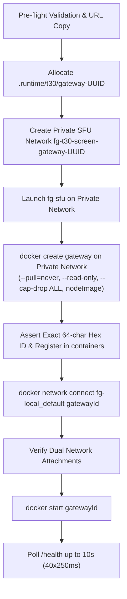

# T30 Isolated Direct Gateway Placement Diagnostic Plan

This document details the isolated gateway placement diagnostic proposal under [AGENTS.md](file:///E:/FGweb/AGENTS.md), [.agents/rules/08-testing-and-evidence.md](file:///E:/FGweb/.agents/rules/08-testing-and-evidence.md), and [.agents/rules/09-voice-and-live.md](file:///E:/FGweb/.agents/rules/09-voice-and-live.md).

---

## 1. Context and Prior Idle Route Findings

Root execution of the isolated database route benchmark ([db-route-results-review1.json](file:///E:/FGweb/code/quality/evidence/T30/db-route-results-review1.json)) completed 80 measured queries and 12 control warmups across two sequential A-B-A-B cycles with identical Node.js image, `pg` driver, credentials, and connection pool options:
- **Route A (Host-published)**: p50 3.763ms, p95 10.714ms, max 18.30ms
- **Route B (Direct container bridge)**: p50 0.702ms, p95 1.945ms, max 2.90ms

### Candid Interpretation & Diagnostic Boundaries
> [!IMPORTANT]
> The benchmark demonstrates network stack and port forwarding overhead for **idle synthetic SELECT 1 queries only**.
> - It does **NOT** prove the aggregate cost of the 158 queries executed in the Native58 switching window (p50 41.64ms, p95 140.1ms, max 287.46ms).
> - It does **NOT** prove the unassociated PostgreSQL SCRAM authentication stall (5.0s timeout ending 10.866s prior to the window).
> - It does **NOT** prove a root causal mechanism for delayed RTP media packet delivery.

Accordingly, direct gateway placement is proposed strictly as an **isolated one-variable diagnostic hypothesis** to measure whether container-to-container database routing affects live gateway signaling and query performance under genuine SFU load, without modifying application source, database schema, lease authority, or test assertions.

---

## 2. Gateway Placement Architecture

In the canonical fixture helper ([private-gateway-observer-reviewed2.mjs](file:///E:/FGweb/code/quality/evidence/T30/private-gateway-observer-reviewed2.mjs)):
- The gateway container is attached solely to the private isolated SFU network `fg-t30-screen-gateway-<uuid>`.
- The database connection string hostname is forced to `host.docker.internal`, routing traffic across the Docker bridge and Windows host port forwarding loopback into container port 5432.

In the proposed diagnostic helper ([private-gateway-observer-direct1.mjs](file:///E:/FGweb/code/quality/evidence/T30/antigravity-native58-direct-gateway-1/private-gateway-observer-direct1.mjs)):
- The gateway container maintains a **dual-network attachment**:
  1. `fg-t30-screen-gateway-<uuid>`: Private network for isolated SFU communication (`http://fg-sfu:7880`).
  2. `fg-local_default`: Existing application network for direct PostgreSQL connection (`fg-local-postgres-1:5432`).
- The database connection URL replaces only `hostname` (`fg-local-postgres-1`) and `port` (`5432`), preserving credentials, database name, `search_path`, SSL configuration, and query options byte-equivalent.

---

## 3. Pre-flight & Privacy Controls

Before creating any runtime directories, writing configuration files, or launching containers:
1. **URL Validation**:
   - Asserts `databaseURL` protocol is `postgres:` or `postgresql:`.
   - Asserts hostname is `localhost` or `127.0.0.1`.
   - Extracts published host port (e.g. 55432).
2. **Container & Network Health**:
   - Inspects `fg-local-postgres-1` and `fg-local-redis-1`: asserts `Running === true` and `Health.Status === 'healthy'`.
   - Asserts `fg-local-postgres-1` is attached to `fg-local_default` with alias `fg-local-postgres-1`.
   - Asserts published port binding on `5432/tcp` matches the extracted published port.
   - Inspects `fg-local_default`: asserts network ID matches PostgreSQL container network ID and container ID is mapped.
3. **Zero-Leakage Privacy**:
   - Zero inspection Config, environment variables, raw errors, URLs, or credentials are dumped to console or logs.
   - Pre-flight snapshot of container IDs and network mappings is recorded for fail-closed verification.

---

## 4. Container Lifecycle: Create &rarr; Connect &rarr; Start

The single `docker run -d` invocation is replaced with an explicit, multi-stage lifecycle:

- **Security Profile**: Pinned `nodeImage` (`node:24.21.0-bookworm-slim@sha256:...`), `--read-only`, `--cap-drop ALL`, `--security-opt no-new-privileges`, `--user node`, `--label fg-owner=t30-gateway-<uuid>`.
- **Zero Override**: No `--add-host` host-gateway overrides used; no public SFU ports opened; existing PostgreSQL container network attachments left completely untouched.

---

## 5. Fail-Closed Cleanup & Error Recovery

### Interrupted Create Recovery
If `docker create` is interrupted after container creation but before ID assignment:
- Inspects `/fg-gateway-<uuid>` and verifies label `fg-owner=t30-gateway-<uuid>`.
- Recovers ONLY that exact container ID; never sweeps unrelated containers.

### Fail-Closed Cleanup
In `close()`:
1. Stops and removes all owned containers (`gateway`, `sfu`, and `turn-shaper` if enabled).
2. Removes private SFU network.
3. Verifies container and network removal.
4. **Main Service Invariant Verification**:
   - Re-inspects `fg-local-postgres-1` and `fg-local-redis-1`: asserts IDs, Configs, network maps, and health statuses remain byte-identical.
   - Re-inspects `fg-local_default`: asserts network ID and container list remain byte-identical.
   - If any verification check fails, sets `mainServicesUnchanged = false` and throws an `AssertionError` immediately (fail-closed), preventing false completion reporting.

---

## 6. Observer & Diagnostic Preservation

All observer and telemetry mechanisms from [private-gateway-observer-reviewed2.mjs](file:///E:/FGweb/code/quality/evidence/T30/private-gateway-observer-reviewed2.mjs) are preserved byte-exact:
- Comprehensive regex redactor for tokens, JWTs, SQL queries, credentials, and parameters.
- `[FG_GATEWAY_HEALTH]` parser on `SIGUSR2`: validates strict JSON keys, positive sample count, 0 failures, 0 drops, and stopped timer within 3,000ms deadline.
- Diagnostic logs and state files written to `FG_T30_EVIDENCE_DIR` on startup failure.
- `AggregateError` propagation preserving original startup error identity alongside observation/cleanup errors.

---

## 7. Deliverables & Next Verification Controls

### Delivered Artifacts
- [private-gateway-observer-direct1.mjs](file:///E:/FGweb/code/quality/evidence/T30/antigravity-native58-direct-gateway-1/private-gateway-observer-direct1.mjs): Diagnostic helper copy implementing direct placement.
- [private-gateway-observer-reviewed2.mjs](file:///E:/FGweb/code/quality/evidence/T30/antigravity-native58-direct-gateway-1/private-gateway-observer-reviewed2.mjs): Compatibility copy ensuring direct import resolution.
- [plan.json](file:///E:/FGweb/code/quality/evidence/T30/antigravity-native58-direct-gateway-1/plan.json): Machine-readable specification with invariants and disclaimers.
- [shortplan.md](file:///E:/FGweb/code/quality/evidence/T30/antigravity-native58-direct-gateway-1/shortplan.md): Architectural analysis and protocol plan.
- [.doc/history.md](file:///E:/FGweb/.doc/history.md): Truthful actual-time delivery entry.

### Planned Controls for Root Execution
1. **Full Normal Stack Verification**: Actual SDK private WS / PG HTTP / auth / ACL / TURN / CSP / assets / inspector cleanup.
2. **Failure Injection Controls**: Intentional observer IO and startup failure cleanup controls verifying fail-closed assertions.
3. **Source Reverse Checks**: Diffing direct helper against canonical helper ensuring zero collateral drift outside URL preflight and container lifecycle hooks.
4. **Optional Headed Diagnostic 4**: Identical diagnostic run (with 15 pending-frame bytebounds controls GREEN) evaluating direct bridge database routing as a single isolated variable.

> [!NOTE]
> No tests, Docker containers, or background processes were executed in this turn. All changes remain confined to `code/quality/evidence/T30/antigravity-native58-direct-gateway-1/**` and `.doc/history.md`. `nativeAcceptance: false` preserved throughout.
